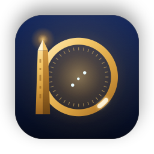
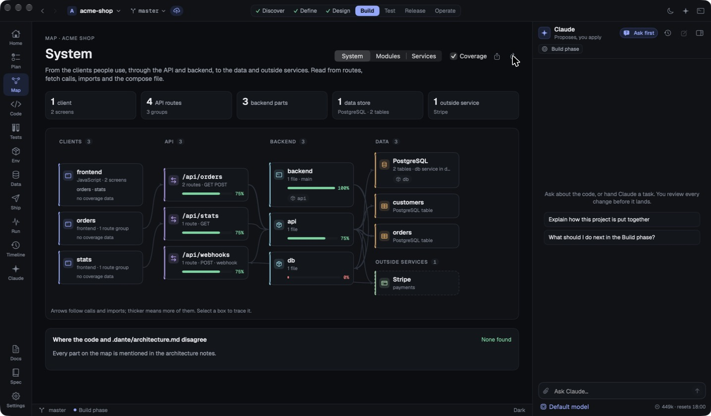
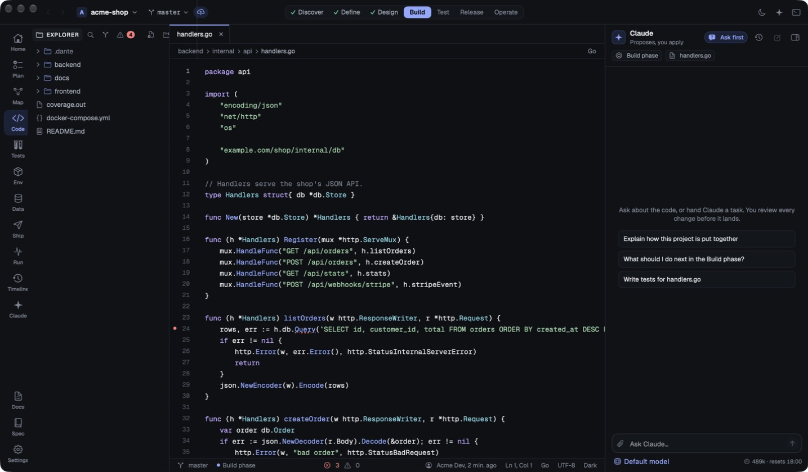
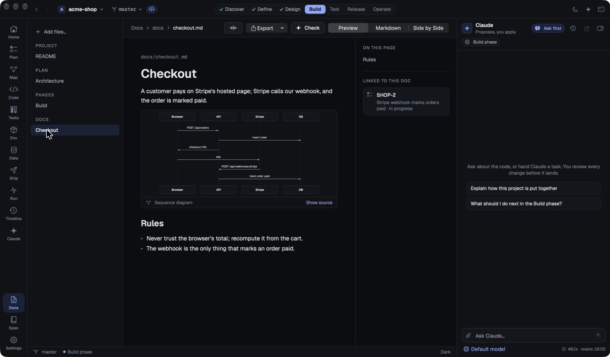
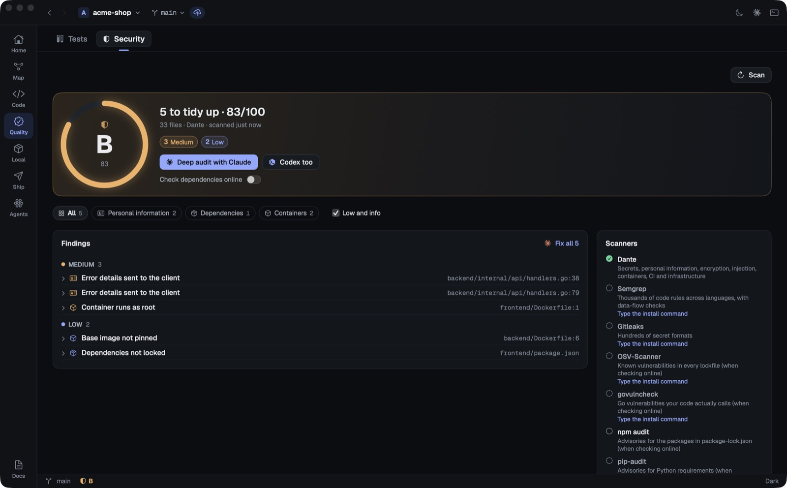
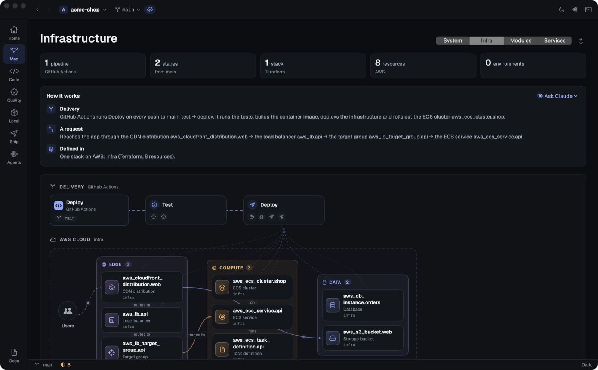

<p align="center"></p>

<h1 align="center">Dante</h1>

<p align="center">A native macOS IDE where Claude and Codex work beside you, and Dante shows you the whole system they're working on.</p>

Dante reads a project and draws it: screens, API routes, packages, tables, outside services, pipelines and infrastructure, straight from the code. Claude or Codex leads, the other reviews, and local models take the small jobs. Every edit arrives as a diff you approve, a whole turn can be undone, and jobs run in their own worktrees beside you.



| | |
| --- | --- |
|  |  |
|  |  |

## Install

Download the DMG from [Releases](https://github.com/Dantevdm/Dante-IDE/releases), open it and drag Dante to Applications. Builds that aren't notarised yet need a right-click → Open the first time (or `xattr -dr com.apple.quarantine /Applications/Dante.app`).

To open projects from the terminal, Settings → Tools → dante command links `dante` onto your PATH; then `dante .`, `dante -n ~/other-project` or `dante src/main.go:42`.

You'll want [Claude Code](https://claude.com/claude-code) installed and signed in for the Claude features, and git. Settings → Tools lists the optional extras (language servers, database clients, the GitHub CLI, Docker) with the command to install each.

## The places

The rail has seven places; some have tabs.

- **Home**: the project at a glance, and what changed since you were last here
- **Map**: the system drawn from the code, and the infrastructure and pipelines that ship it
- **Code**: the editor, language servers, git, search, the debugger and the terminal
- **Quality**: Tests and Security
- **Local**: Services (Docker Compose), Data (your databases) and Health (alarms, checks, production logs)
- **Ship**: Release and History
- **Agents**: Jobs, Activity, Setup and HQ
- **Docs**, in the footer: markdown, native diagrams, PDFs and Word files, and the motion studio

Beside them: the agent panel, the menu bar orb, the Stage and voice. The sections below go through the big pieces.

## Agents in charge

Dante is built around agents rather than bolted onto them.

- **Claude or Codex leads, the other reviews.** Claude Code and OpenAI's Codex both run as full agents in the panel, signed in with your own plans. Switch who's in charge mid-conversation and the new lead picks up the thread. When Claude's plan is nearly out, Dante can hand over to Codex and resend the request Claude couldn't finish.
- **Every edit is a diff you approve.** Pick how much the agent may do on its own: ask for everything, allow edits, or allow everything. Read-only commands such as `git status` and `ls` go through without asking. "Always allow" saves the rule to Claude Code's own settings. Edits from a turn can be undone in one go, with files it created removed (shell commands' side effects can't be undone). Apply all approves the waiting edits and, if you like, the rest of the turn.
- **It asks before it guesses.** Clarifying questions arrive as cards to answer, and a reply that ends in a list of options gets chips to click.
- **Local models do the small jobs.** Through Dante's own MCP server (`dante mcp`), the agents can hand summaries, drafts and checks to models in [Ollama](https://ollama.com), picked per kind of job, at no cost. Looker, a local vision model, reads screenshots and images and quotes their text exactly.
- **Cloud agents with your own keys.** Grok (xAI) for a second opinion and Jev for scored decisions, with keys in the Keychain. Those tools always ask first, since they send material off the Mac.
- **Activity tells the story.** Every job, local or cloud, turns and sub-agents included, goes into one ledger: who did what and why, who checked whose work, the cost, and each request as a thread.
- **Setup** lists the project's skills (and suggests new ones from its files), memory files and what they cost per message, MCP servers, plugins and permissions.

### Jobs: agents working beside you

A job is an agent working on its own git branch in a separate worktree, outside the repo, while you keep working in the main checkout.

- Start one from the panel, the Jobs board, or the terminal: `dante job "fix the flaky login test" --away 30`.
- A guard refuses pushes, merges, rebases, branch switches, deletions, `reset --hard`, releases, deploy tools, cloud CLIs and edits outside the worktree, whatever the approval level.
- **Away mode** approves edits and build, test, lint and format commands for a set time. Anything else waits in the inbox, and when the time runs out every step asks again.
- **Job types** in `.dante/jobs/<id>.md` describe recurring work: a builder that takes a task from `tasks.yaml`, or a pipeline watcher that Dante starts by itself when CI fails on your branch.
- Merge brings a job's work into your branch; discard throws it away. Both ask first.

## Map: your system, from the code

The Map reads the code and draws the system: clients and their screens, API route groups, backend parts, tables, outside services and webhooks, linked by the calls the code really makes. Nothing needs configuring.

- **Open any box to go inside it**: a part opens into its folders, a folder into its files, a file into its methods, down to a method's code, with the routes it serves, the tables it reaches and the classes it uses. A table traces back through the code that queries it to the routes that reach it.
- **Open routes are flagged.** Spring Security config is read, every route is marked secured or open, and each open one gets a reason (health, sign-in, webhook, docs) or is called out as a concern.
- **Schemas from the migrations.** The repo's SQL is replayed in migration order into table schemas you can copy as DDL, markdown, a SELECT or an ER diagram. The queries in the code (WHERE clauses, Spring Data methods, queries inside loops) become index suggestions with the SQL to fix them.
- **Coverage per part** from lcov, Go and Cobertura reports, environment variables per part with likely secrets flagged, and drift against `.dante/architecture.md`, with a Mermaid export into it.
- **Infra view**: CloudFormation, SAM, Terraform and ARM templates with Azure DevOps, GitHub Actions and GitLab pipelines, drawn as resources by tier with each pipeline stage linked to what it deploys. Dante says in plain sentences how a change ships and how a request travels. The agent in charge can explain or review it, or write the pipeline or infrastructure that's missing.
- A web client or screen opens in the browser: Dante finds its port and route, and starts the dev server only when you ask.

## Data: your databases, safely

Data finds the project's PostgreSQL, MySQL and SQLite databases in compose files, `.env` URLs, framework config and containers that belong to the project. It shows what the code uses (drivers, ORMs, migrations) even before there's a database.

- Browse tables a page at a time with sorting and filters, follow foreign keys both ways, and see the live schema as an ER diagram.
- Run SQL scripts in one session. Dante checks before anything that drops or rewrites a whole table.
- **Query plans explained**: tables read row by row are flagged, with the index that would help.
- **Migration preview**: see what a script or migration file will change before it runs, checked against the live schema: missing tables, NOT NULL columns with no default, index builds that lock, rows a drop would delete.
- **New database** sets up a Compose service (or a SQLite file) with a generated password on a free port, and can remove it again cleanly.
- The agent writes queries from a description and fixes failing ones, with the schema as context.
- Passwords live in the Keychain and connections stay on this Mac. A database that isn't on this Mac opens read-only.

## Security layer

Security runs on every project, offline by default, and sits between the agents and your code.

- **The scanner** checks every tracked file for secrets, personal information (POPIA), weak encryption, injection, and container, CI and infrastructure problems. South African ID numbers and card numbers are validated properly (date, citizenship digit, Luhn), so test data and providers' test cards don't cry wolf. Severity drops a step in tests, except for secrets.
- **Your installed scanners join in**: Semgrep, Gitleaks, OSV-Scanner, govulncheck, npm audit and pip-audit. The ones that send your dependency list to a service (OSV-Scanner, govulncheck, npm audit, pip-audit, and Dante's own OSV.dev lookup) run only once you turn on online checks.
- **One report, one score.** Findings are merged by file, line and problem, ranked, and scored out of 100; a single critical caps the score at 49. Accepted risks go in `.dante/security.yaml`, each with a reason, and a line can be waved through inline with `nosec` or `dante:ignore`.
- **The agents fix and check.** Fix hands findings to the agent in charge and asks the other to check the work. Audit asks for a read-only review against POPIA (sections 19, 22 and 72).
- **Edits are scanned before you approve them.** If an agent's edit adds a high or critical finding, it asks you at any approval level, and Apply all skips it.
- **The agents see the report** through Dante's MCP server, so a security question starts from what Dante found.
- **In CI too**: `dante scan --fail-on high` exits non-zero when it finds something at that level (`--json` for the full report, `--online` for dependency advisories).

## Voice, the orb and the Stage

- **Push to talk** with ⌃⌥Space or the Talk button. Speech is recognised on the Mac. Say "stop", "yes", "no", "switch to Codex", "status" or "how much usage is left"; anything else goes to the agent in the frontmost project.
- **Voice knows the app.** Every page has a spec, so "show me the infrastructure", "what's on this page?" and "what can you do?" work, and the agents can open pages for you as they explain.
- **Replies are read aloud as they stream**, with code skipped, in a natural voice ([Kokoro](https://github.com/thewh1teagle/kokoro-onnx), running on the Mac) or the system voices. "Hey Dante" is there too, off by default, and works only when the Mac can recognise speech offline.
- **The orb** in the menu bar shows what the agents are doing: thinking, acting, waiting for you, done, listening, tired as the usage window fills, asleep when the plan runs out. Sub-agents and local jobs bud off it as satellites and merge back when they finish.
- **The Stage** is Dante full screen on a TV, or in a window: the orb in a heads-up display, the agents at work, today's tally, the reply as it's spoken, and approvals you can answer with Return.

## Search, by text or by meaning

Find in Project searches by text, word or regex, with previewed replace. Meaning mode searches by what code does ("where do we retry payments?") using an embedding model in Ollama. The index lives on this Mac, never in the repo, and skips env files, lockfiles and `never` paths. The agents get it as a tool too (`search_code`), and so does the terminal (`dante search`).

## Motion studio

In Docs, the agents make videos, slide decks and explainers from the real system, in the project's brand (`.dante/brand.yaml`), narrated in Dante's voice and rendered to 1080p or 4K. A new piece goes through four steps: the idea, the look (a live gallery of twenty animation styles plus illustration kits), the brief, and whether Claude, Codex or both make it. three.js, hairline and Open Peeps are bundled, so the agents can use them with nothing to install.

When both agents make a piece, you switch between their versions, play them side by side in step, and keep the one you like. The other agent critiques a version from a contact sheet of its beats, as a motion designer who didn't make it, and you send its notes back to the maker. Dante's lint flags anything that would break a frame-accurate render. A piece exports as an MP4, as one HTML file that plays offline in any browser (the libraries go inside it), or as a PDF of its slides or storyboard. Decks are presented full screen on the Stage, moved on with the keys, a clicker or "next slide".

## Agent HQ

A little easter egg under Agents › HQ: the agents in an isometric office around a glowing brain, and the office grows with your app. Every job an agent does and every commit counts. It starts as an empty lot and becomes a garage, a studio, an office, headquarters and finally a campus, with trees for the files and a tower under the brain for the commits.

Each room is a kind of work: research, backend, front-end, DevOps, quality, docs, security and data. A room opens with its first job and is furnished as its work adds up: a desk, then a rug and lamp, a second desk, a bookshelf, and a gold-trimmed flagship with trophies after that. Rooms nobody uses go dusty, busy roads wear wider and light up, and the sky follows the time of day. Whoever is working sits in the room of the file they're editing, with a tag saying what they're doing. The story so far lists each milestone, and *Watch it grow* replays the whole history.

## What stays on your Mac

Connections, database passwords (in the Keychain), the search index, test history, job records and the agent ledger all stay on this Mac. Dante never reads Claude Code's or Codex's credentials. Your API keys reach Dante's MCP server through a private file that is removed when the agent stops, never on a command line. Online dependency checks and cloud agents are off until you turn them on.

<details>
<summary><b>Everything else that works today, in detail</b></summary>


- Launch screen with recent projects, plus new project, open folder and clone
- Dark, Light and Paper themes (⌥⌘T to cycle), set in Geist and Geist Mono (bundled; a setting switches to the system fonts)
- File explorer, tabs, and a TextKit 2 code editor with tree-sitter highlighting (Swift, Python, JavaScript, TypeScript, Go, Rust, JSON; regex for the rest), line numbers and auto-indent
- Language servers for diagnostics, hover info (rest the pointer on a symbol) Jump to Definition (⌘-click or ⌃⌘J) and Go to Symbol (⌘⇧O: the file's symbols, then matches across the project, with Dante's own declaration scan where no server covers a language or its index is empty): SourceKit-LSP, typescript-language-server, Pyright, gopls, rust-analyzer and clangd, whichever are installed. Problems are underlined, marked in the gutter, listed from the status bar and gathered for the whole project in the sidebar's Problems tab (⇧⌘M), and Fix hands one, or all of them, to Claude. Claude always sees the open file's problems
- Split editor (⌘\): two panes side by side over the same tabs; a tab opens in the focused pane (marked in its path bar), click a pane or press ⌥⌘\ to switch, × closes the split
- Code completion from the language server as you type (or ⌃Space), fuzzy-filtered, with snippets whose first placeholder is selected; Tab or Return accepts. Find References (⌃⇧⌘F) lists every use in the Search tab; Rename Symbol (⌃⌘E) renames across open and closed files; Format Document (⌃⇧I). Rename and format are undoable
- Remote projects (⌃⌘O): open a folder on another machine over ssh. Dante keeps a copy here in step with rsync, and runs git, tests, Claude Code, the terminal, Docker and database clients, and the language servers it finds on the host, forwarding service ports here. Needs ssh keys or an agent, and rsync on the host
- Debugger (Debug tab, F5): click a line number to set a breakpoint, then run the open file's Go package (Delve) or Python script (debugpy) through the Debug Adapter Protocol. Paused lines are highlighted; the tab shows the call stack, variables to expand, the program's output and an Evaluate field. Step over, into and out with F6, F7 and F8, F9 toggles a breakpoint, ⇧F5 stops. Breakpoints are kept per project on this Mac
- Claude in the editor: ⌘I (or Edit with Claude… in the editor's menu) opens a bar above the code. Describe a change to the selected lines, or code to write at the caret; Claude's proposal shows as a diff to accept (⌘↩), refine with another instruction, or reject. Nothing changes until you accept, and accepting is one undo. Ask Claude About Selection attaches the selected lines to the Claude panel
- Settings (⌘,): theme, font size and Geist or system fonts; indent width, line wrapping and completion while typing; on save, format with the language server, trim trailing whitespace and end with a newline; auto-save after a delay or when Dante loses focus; Claude's model and whether it asks clarifying questions first
- Git changes in the gutter: added, modified and deleted lines since the last commit, updated as you type and when HEAD moves
- Blame for the caret's line in the status bar (who and when; unsaved edits show as not committed yet). Click it for the commit, Show Commit, Copy Hash or the line's whole history
- Find in Project (⇧⌘F): search every file (open ones as edited) with match case, whole word and regex, grouped by file; click a result to open it with the match selected. The chevron opens Replace: each result previews its change, hover to replace one match, a file, or leave a match out, and Replace All (⌥⌘↩) asks first. Open files change in the editor, undoable; others are saved
- Integrated terminal running your login shell (⌃`)
- Claude pair panel (⌘L): runs Claude Code headless in the project. Every edit arrives as a diff to apply or decline, and commands wait for your go-ahead at the approval level you choose. It sees which file you have open
- Command palette (⌘K, or ⌘P for files): fuzzy file search, docs, actions, and Tab to ask Claude
- Live file watching: the explorer, open tabs and branch stay current when files change outside the editor
- Home: the project at a glance, with recent commits, local services, and what Claude is told about the project. When you come back to a project, "Since you were last here" lists the commits, changed files and any branch switch since Dante last closed it
- Explorer: new file and new folder buttons (type `folders/like/this.swift` to create the folders too), and right-click to rename, duplicate, move to the Trash, copy paths or ask Claude about a file. ⌘-click and ⇧-click select several items, and the menu, ⌘C, ⌘V and ⌫ act on all of them. Copy files or folders in Finder and paste them into a folder (⌘V or Paste), or drop them from Finder to copy them in; drag files onto folders to move them (open tabs follow). Changed files are coloured by their git status
- Source control: a Changes tab beside Explorer and Search lists staged, unstaged and conflicted files; click one for its diff, hover to stage, unstage or discard (new files go to the Trash). Commit with ⌘↩ (everything, when nothing is staged), amend, or commit and push; ✦ has Claude write the message from the staged diff in the repository's own style. The branch in the title bar switches, creates and publishes branches, and shows ↑↓ to push or pull. Git menu: Source Control (⌃⇧G), Push, Pull, Fetch, Switch Branch (⌃⇧B)
- Docs: renders the project's markdown with an outline and opens files it mentions. ```mermaid blocks (flowcharts, sequence and ER diagrams) are drawn natively in the theme's colours. PDFs, images and Word files under docs/ show alongside; drop files on Docs to add them, then ask Claude about one or have it written up as a markdown spec. Markdown images render inline. Export a doc as a PDF or print it (⇧⌘E, ⌘P), set in the Paper theme with page breaks between blocks. Switch a doc between Preview, Markdown and Side by Side: edit the source without leaving Docs, with a live preview that follows the cursor; it shares unsaved changes and ⌘S with the Code tab
- Attach files for Claude: drop, paste or pick images, PDFs, Word/RTF/HTML documents or code into the Claude panel. Images and PDFs go to Claude as themselves; documents are converted to text
- Claude asks before it guesses: with Ask first on (the default), Claude asks clarifying questions before ambiguous work, and you answer them as cards in the panel
- Back and forward through the screens you've visited: the mouse's back and forward buttons, ⌃⌘← / ⌃⌘→, or the arrows in the title bar
- Several terminals as tabs (⌃⇧` for a new one); hidden tabs keep running
- Cloning shows git's progress, and if the server wants a password git can't ask for, Dante finishes the clone in Terminal and opens it when done
- Layouts follow the window: pages fill wide and ultra-wide screens, panels can be dragged much wider, and Docs can switch to full width
- Tests (⌘U): runs the project's tests (Swift, cargo, go, npm/pnpm/yarn/bun, pytest, or `test.command`), groups results by suite, re-runs just the failures (⇧⌘U) or any single test, and hands failures to Claude. Written lists every test in the code by category (Unit, Integration, End-to-end, UI, Performance, or your own from `test.categories` globs in project.yaml) and file, with each one's last result; results can be grouped by category too. History charts runs on this Mac and flags flaky and long-failing tests. Untested lists the functions and types no test names, logic before views, with Write tests per file and a concrete brief for Claude
- Env: Docker Compose services with start, stop, logs, and Dockerfiles that are missing. Logs follow every service or one, with search (highlighted, or only matching lines), a level filter, the app's timestamps set apart, errors and warnings marked, and copy. They open at the newest line and stay there as lines arrive; scroll up to read back (following stops) and Jump to latest to return. The last 500 lines load by default, or 2,000, 10,000 or everything. Start and Rebuild show compose's output as it runs, and each service that isn't up says why: a failing health check (with the check's own error), a port something else on this Mac already holds, or a dependency it's waiting on. Find the cause hands that to Claude. A Ports card shows every port the compose file publishes and anything else listening that was started from the project, with the process, its command line and uptime; Stop asks it to quit. Before each start Dante checks the ports and, if one is taken, offers to stop what holds it, publish the service on the next free port (editing only that line of the compose file), or start anyway
- Data: the project's databases (PostgreSQL, MySQL, SQLite). Dante finds them in compose files, `.env` URLs, Prisma/Rails/Django config and SQLite files, and says what the code uses (drivers, ORMs, migrations) even before there's a database. Browse tables a page at a time with sorting and a WHERE filter, see columns and foreign keys both ways, run SQL scripts in one session (⌘↩, with a check before anything that drops or rewrites whole tables), explain queries (with the tables read row by row to filter, the index that would help, and Claude to talk the plan through), preview what a script or migration file changes before it runs (checked against the live schema: missing tables, NOT NULL columns with no default, locking index builds, rows a drop deletes), export results, and see the live schema as an ER diagram you can save to docs. New database sets up a Docker Compose service (or a SQLite file) with a generated password in `.env`, on a free port, and starts it. Talks through `psql`, `mysql` and `sqlite3`, or the client inside the compose container; passwords live in the Keychain, connections stay on this Mac, and anything not on this Mac opens read-only. Claude writes queries from a description and fixes failing ones, with the schema as context
- Map: the system map (clients and their screens, API route groups, backend packages, data stores and tables, outside services and webhooks, linked by real calls), plus modules from `Package.swift` or Go imports and compose services; an inspector with environment variables and coverage, drift against `.dante/architecture.md`, and a Mermaid export into it
- Ship: CI runs from `gh`, a changelog drafted from conventional commits since the last tag, a release checklist, and local tagging.
- Health: alarms, health checks and a production log stream from `operate:` in `.dante/project.yaml`. Alarms come from CloudWatch (read-only, through the `aws` command line and its existing login) or any command that prints them as JSON (`[{ name, state, reason, updated, url }]`, for Datadog, Grafana, Alertmanager…). Firing alarms sort first; Investigate hands the alarm and matching log errors to Claude, and Notify me (off by default) sends a macOS notification when one starts firing. Log errors are grouped
- Timeline: commits and tags, Claude Code sessions run in the project folder, test runs and GitHub Actions runs in one stream grouped by day. Click a commit to show it, a Claude session to resume it in the terminal, a CI run to open it
- Claude rules in `.dante/project.yaml` (`claude: propose / flag / never`): flagged paths are called out on the diff, and never-paths are refused, reads included
- Quitting with unsaved files asks once for every window: save, discard or cancel

</details>

## Roadmap

Dante's own task list is [`.dante/tasks.yaml`](.dante/tasks.yaml); this is the short version.

**In progress**

- **Walk and work**: jobs, away mode and job types are in ([plan](docs/plans/walk-and-work.md)); next are away budgets, then an iPhone and iPad companion (QR pairing, a voice loop with AirPods, Live Activities and actionable notifications, an iPad desk layout) and a verifier that drives its own browser.

**Next**

- **Discovery**: a freshly opened project paints the picture of everything Dante found, on Home.
- **Motion everywhere**: the Infra view's animated links and pulses in Tests, Data, Services and Agents.
- **Hands**: let an agent open apps and control the Mac, with a visible kill switch (needs Accessibility, asked first).

**Waiting for review** (built, being tried in daily use)

Agent HQ, the motion studio, presence orb and constellation, the Stage, full voice, Codex or Claude in charge, local models and Looker, search by meaning, the security layer, cloud agents with your own keys, approvals, remote projects over SSH, the debugger, the native Settings window, alarms in Health, and the release build.

## Requirements

- macOS 15 or later
- Xcode 16 or later (Swift 6)
- [Claude Code](https://claude.com/claude-code), installed and signed in (`claude auth login`), for the Claude panel

## Build from source

```bash
scripts/bundle.sh --open
```

This builds a release binary and wraps it in `build/Dante.app`. Use `scripts/bundle.sh debug --open` for a debug build. To open a folder straight away:

```bash
open build/Dante.app --args ~/path/to/project
```

Files after the folder open in tabs: `--args ~/project ~/project/Sources/main.swift`.

`scripts/release.sh 0.2.0` builds `build/Dante-0.2.0.dmg`; it signs and notarises when `DEVELOPER_ID` and `NOTARY_PROFILE` are set (see the script).

Run the tests:

```bash
swift test
```

## Layout

| Path | What's there |
| --- | --- |
| `Sources/DanteKit` | Models: themes, workspace, documents, git, the Claude Code and Codex sessions, agents, security, search, motion, and the data behind each place (Docs, Testing, Environments, Data, Map, Infra, Release, Operate) |
| `Sources/DanteEditor` | The TextKit 2 editor, line-number gutter, highlighters and bundled fonts |
| `Sources/DanteApp` | The SwiftUI app: launch screen, workspace, the place screens (`Views/Areas`), the motion studio (`Views/Motion`, with the bundled libraries in `Resources/MotionLib`), presence, voice, terminal, menus |
| `spec/` | A spec for every page, which voice and the agents use to find their way |
| `Tests/` | Swift Testing suites for DanteKit and DanteEditor |
| `design/` | Generator for the design canvas and its HTML screens |
| `.dante/` | Dante's own project spec |

## The `.dante` folder

Everything here is optional; Dante works out the rest from the code.

```yaml
# .dante/project.yaml
name: My App
claude:                        # rules for Claude and Codex
  never: [secrets/, "**/*.pem"]   # refused, reads included
  flag: [migrations/]          # called out on the diff
  propose: [src/, tests/]      # edits elsewhere get a note
test:
  command: make test           # otherwise Dante works it out
  categories:
    Integration: ["tests/integration/**"]
operate:
  checks:
    - { name: api, url: "https://api.example.com/health" }
  logs: fly logs -a my-app     # any command that streams production logs
```

- `brand.yaml`: colours, fonts, logo, motion and voice for the motion studio (written from the project's own styles the first time)
- `security.yaml`: accepted risks, each with a reason
- `jobs/<id>.md`: job types (when one starts, what it may touch and run, the brief)
- `architecture.md`: notes the Map checks for drift, and where it exports its Mermaid diagram
- `tasks.yaml`: a plain task list, if you keep one

Dante's own `.dante/` folder is a working example.

Geist and Geist Mono are © The Geist Project Authors, from [vercel/geist-font](https://github.com/vercel/geist-font), under the SIL Open Font License 1.1 (`Sources/DanteEditor/Resources/Fonts/OFL.txt`).
